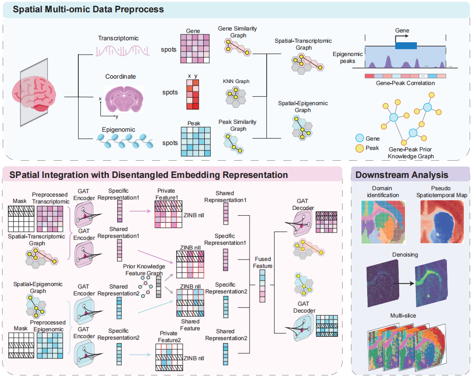

# SPIDER: SPatial Integration with Disentangled Embedding Representation

## Overview
Effectively leveraging the interaction relationships and complementary information of different modalities is crucial for integrating multimodal data and illustrating the complex regulaory landscape. Here, we present SPIDER (SPatial Integration with Disentangled Embedding Representation), a disentangled graph neural network model with disentangled learning for spatial transcriptomic and epigenomic integration.
